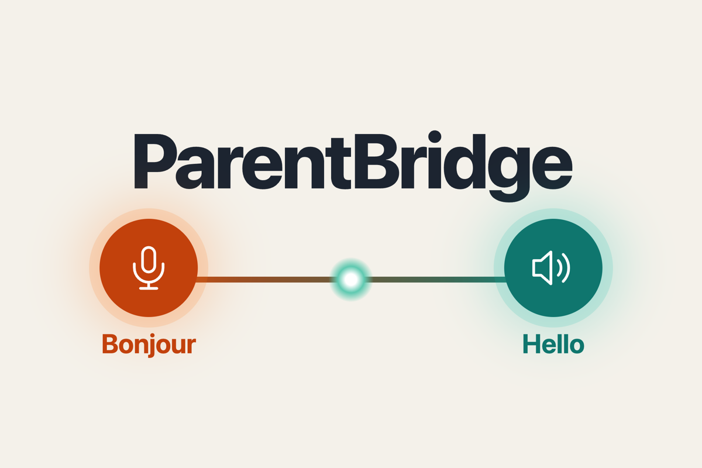
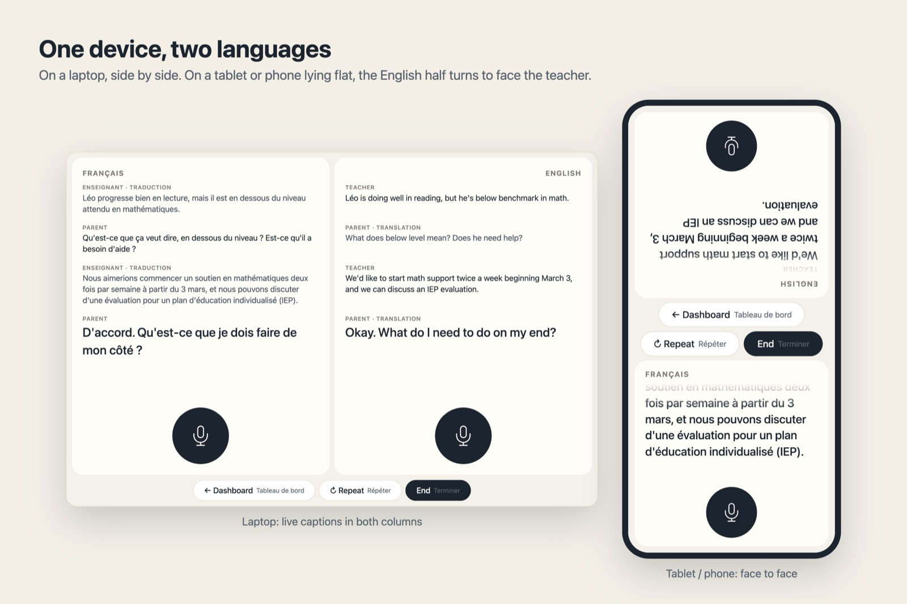
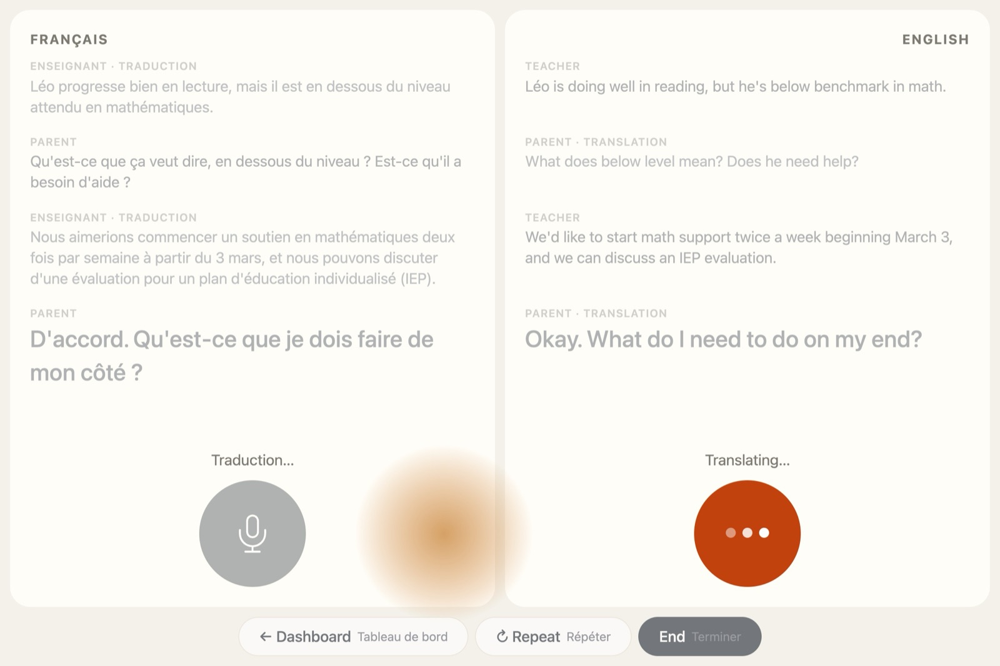
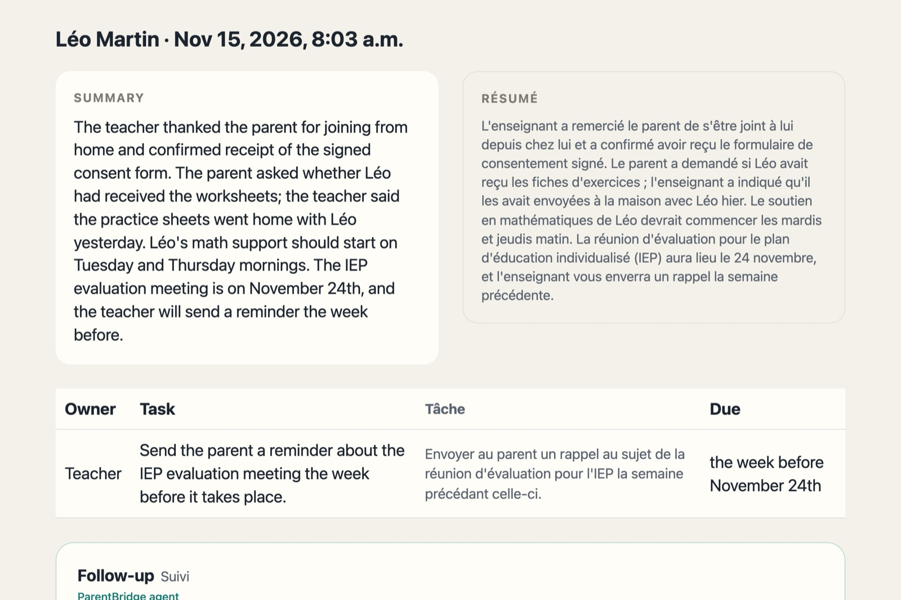
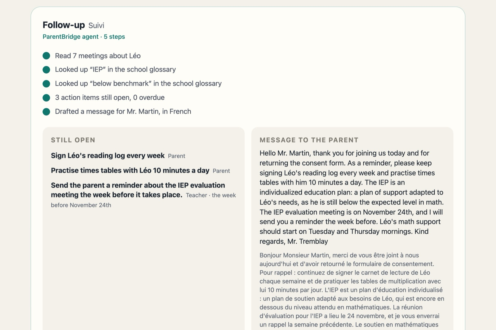
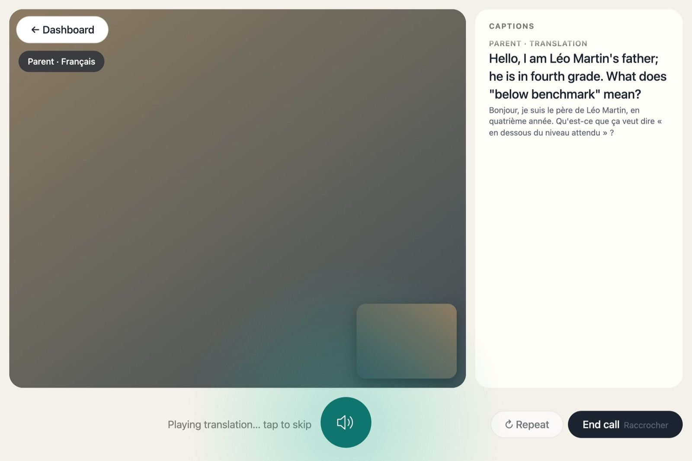
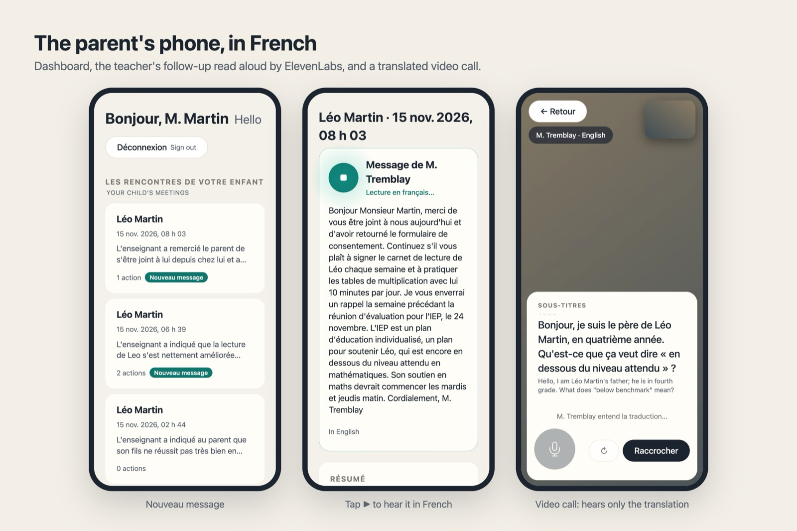

# ParentBridge



**A live voice interpreter for parent–teacher meetings, in person or on video, plus an AI agent that follows up with the parent in their own language.**

A French-speaking parent and an English-speaking teacher talk to each other directly. Each person taps their mic, speaks, and the other hears it in their own language about two seconds later, with captions in both languages. When the meeting ends, ParentBridge writes a bilingual summary with action items. An agent then reads the student's past meetings, catches commitments that slipped, and drafts a follow-up the parent can read, or hear, in French.

Built in one weekend at **Hack The Nest 2026**.

- **Live app:** https://translate-hackthenest2026.onrender.com (the free tier sleeps, so the first load can take about a minute)
- **Try it without an account or a mic:** https://translate-hackthenest2026.onrender.com/?mock=1. Sign in with any email and the password `demo`. Turns, the summary and the agent return canned data.

> All people, students and schools in this project are fictional (student "Léo Martin, Grade 4, Maple Ridge Elementary").

---

## Why

When a family doesn't share the school's language, the parent–teacher meeting is the conversation they most need and understand least. The usual fixes put a middleman in the room: an interpreter booked days ahead, or a remote interpreter on a screen. ParentBridge is a direct link. Nothing to book, no one to wait for, just two people talking.

## Features



- **Tap to talk, two languages.** One mic per person, and the button decides the language. A full turn (speech → translation → voice) takes about 1.5–2 s.
- **In person or on video.**
  - **In person:** one laptop with the two languages side by side. On a tablet or phone lying flat on the table, the screen splits face to face, with the English half rotated toward the teacher.
  - **On video:** the teacher sends a link and the parent joins from their phone, with no account needed. Video goes peer to peer, and each person hears only the translated voice, never the other's raw audio.
- **Captions in both languages**, plus **Repeat** to hear the last translation again.
- **School glossary.** Terms like "IEP" or "below benchmark" are translated consistently and explained the first time they come up.
- **Bilingual summary and action items** (who, what, by when). It only lists commitments actually stated in the meeting.
- **Follow-up agent.**
  - It reads the student's meeting history with tools, flags open and overdue items, explains jargon, and drafts a message plus questions for the next meeting.
  - Each step streams to the screen as it happens. The teacher reviews the draft and taps Send.
  - The parent sees "Nouveau message" on their dashboard and can tap ▶ to hear it in French.
- **Viewer-first language.** The teacher reads English first and the parent reads French first; the other language is a quieter echo.
- **Accounts for teachers and parents.** A teacher has a dashboard, can start meetings and video calls, and saves summaries. A parent has a read-only dashboard of their child's meetings and messages.

## Screenshots

| | |
|---|---|
|  |  |
| **Translating:** the light travels to the listener and turns teal when the voice starts | **Summary:** both languages, plus who does what, by when |
|  |  |
| **Follow-up agent:** each tool step streams in, then open items and a message for the parent | **Video call:** peer-to-peer video; each person hears only the translation |



## How it works

```
 Parent (FR)                                                          Teacher (EN)
 tap mic ─► MediaRecorder ─┐                                  ┌─► hears English voice
                           ▼                                  │   + captions
              POST /api/turn  (FastAPI)                       │
                ├─ 1. ElevenLabs Scribe v2   speech → French text
                ├─ 2. Claude Haiku 5.5       FR → EN, with glossary + last 6 turns
                └─ 3. ElevenLabs Flash v2.5  English text → voice ─┘

 End meeting ─► POST /api/summary ─► Claude Sonnet 5.5 (structured JSON, Pydantic)
                                     bilingual summary + action items
                                     └─► saved to Postgres (teacher signed in)

 Prepare follow-up ─► POST /api/meetings/{id}/agent   (streams NDJSON steps)
      Claude Sonnet 5.5 + tool runner
        ├─ get_past_meetings()  this student's saved meetings
        └─ explain_term(term)   the school glossary
      ─► open / overdue items, message FR + EN, next-meeting questions
      ─► teacher taps Send ─► parent dashboard ─► ▶ ElevenLabs reads it in French

 Video call:  browsers find each other through /api/calls/{code}/signal (polled mailbox),
              then video + translated turns go peer to peer (WebRTC video + data channel).
```

The frontend keeps the live transcript in memory and sends the last six turns with each request. The database stores only finished summaries, action items and the follow-up the teacher sent. **No audio or full transcript is ever stored.**

## Tech stack

| Layer | What we used |
|---|---|
| Speech to text | ElevenLabs Scribe v2 (`scribe_v2`), with the language set by the button |
| Translation | Claude Haiku 5.5 (`claude-haiku-5-5`) via the Anthropic API |
| Voice | ElevenLabs Flash v2.5 (`eleven_flash_v2_5`), one voice per language |
| Summary and agent | Claude Sonnet 5.5 (`claude-sonnet-5-5`): structured outputs and the Anthropic SDK tool runner |
| Backend | Python 3.11, FastAPI, uvicorn, Postgres (`psycopg`), signed session cookie, `hashlib.scrypt` passwords |
| Frontend | React 19, React Router 7, Vite. `MediaRecorder`, Web Audio API (glow), WebRTC (video calls) |
| Hosting | Render web service + Render Postgres. FastAPI serves the built frontend, so there's one origin and no CORS |
| Development | Claude Code, Figma |

## Run it locally

You need Python 3.11+, Node 20+, an ElevenLabs API key and an Anthropic API key. Postgres is only needed for sign-in and saved meetings; live translation works without it.

```bash
# 1. Backend
python3 -m venv .venv
.venv/bin/pip install -r backend/requirements.txt
cp .env.example .env            # fill in your keys (never commit .env)

# 2. Optional: accounts + demo data (needs DATABASE_URL, SESSION_SECRET, DEMO_* in .env)
.venv/bin/python scripts/seed_teacher.py

# 3. Run: http://localhost:8000 (serves the API and the built frontend)
.venv/bin/uvicorn backend.main:app --reload
```

The microphone only works on `localhost` or HTTPS.

### Frontend development

The React source is in `web/`. The deployed site is the built output in `frontend/`, so never edit `frontend/` by hand.

```bash
cd web && npm install
npx vite          # dev server on http://localhost:5173 (forwards /api to :8000)
npx vite build    # rebuilds ../frontend/ (commit it together with web/)
```

Add `?mock=1` to any URL to fake the whole backend (password `demo`).

### Quick pipeline check (no browser)

```bash
.venv/bin/python scripts/test_roundtrip.py scripts/sample_fr.m4a fr   # STT → translate → TTS → out.mp3
```

## Environment variables

| Name | Purpose |
|---|---|
| `ELEVENLABS_API_KEY`, `ANTHROPIC_API_KEY` | Required |
| `VOICE_ID_FR`, `VOICE_ID_EN` | The voice the parent hears, and the voice the teacher hears |
| `TRANSLATE_MODEL`, `SUMMARY_MODEL` | Optional. Default to `claude-haiku-5-5` and `claude-sonnet-5-5` |
| `DATABASE_URL`, `SESSION_SECRET` | Sign-in and saved meetings |
| `DEMO_TEACHER_EMAIL`, `DEMO_TEACHER_PASSWORD`, `DEMO_PARENT_EMAIL`, `DEMO_PARENT_PASSWORD` | Used only by `scripts/seed_teacher.py` |
| `TURN_URLS`, `TURN_USERNAME`, `TURN_CREDENTIAL` | Optional TURN relay for video calls on cellular data or strict networks |

On Render, set these in the dashboard. Build: `pip install -r backend/requirements.txt`. Start: `uvicorn backend.main:app --host 0.0.0.0 --port $PORT`. Health check: `/api/health`.

## Project layout

```
backend/
  main.py          FastAPI app: routes, sessions, video-call signaling, static frontend
  speech.py        ElevenLabs: transcribe(), synthesize()
  translate.py     Claude: translate(), summarize(), glossary
  agent.py         Follow-up agent: Claude tool runner (get_past_meetings, explain_term)
  db.py            Postgres tables, password hashing, queries
  glossary.json    English → French education terms
web/src/           React app: pages (Login, Dashboard, Meeting, Call, Summary, PastMeeting),
                   api.js (real + mock API), audio.js (glow + iOS-safe playback), lang.jsx (viewer-first language)
frontend/          Build output of web/, served by FastAPI
scripts/           seed_teacher.py (demo accounts + history), test_roundtrip.py
```

## API

| Endpoint | What it does |
|---|---|
| `POST /api/turn` | Audio + speaker + recent history → `{source_text, target_text, audio_b64}` |
| `POST /api/summary` | Transcript → `{summary_en, summary_fr, action_items}` |
| `POST /api/login`, `POST /api/logout`, `GET /api/me` | Session sign-in (teacher or parent) |
| `GET`, `POST /api/meetings` | List meetings (teacher: saved; parent: their child's) / save one (teacher only) |
| `POST /api/meetings/{id}/agent` | Run the follow-up agent; streams steps, then the result (NDJSON) |
| `POST /api/meetings/{id}/followup` | Teacher sends the reviewed message |
| `GET /api/meetings/{id}/followup/audio` | The message read in French (generated on request, never stored) |
| `POST /api/calls`, `GET /api/calls/{code}`, `/api/calls/{code}/signal` | Video-call setup and signaling |

Errors are `{"error": "Français · English"}`, so the UI can show them in the reader's language first.

## Privacy

- No audio recordings, and no full transcripts, are stored. The live transcript exists only in the browser during the meeting.
- The database keeps only meeting summaries, action items and the follow-up the teacher chose to send.
- Passwords are hashed with scrypt and a per-user salt. API keys live only in environment variables.
- The agent's tools are read-only and limited to the signed-in teacher and that student. It never sends anything without the teacher's approval.

## Team

- **Sai:** frontend (React app, recorder, captions, glow and handoff, video calls, dashboards, follow-up UI), design, deploy
- **Evan:** backend (FastAPI, prompts, glossary, database and sign-in), French QA

AI tools used: **Claude** (Anthropic API: translation, summaries, follow-up agent), **ElevenLabs** (Scribe speech-to-text, Flash text-to-speech), **Claude Code** (development).
